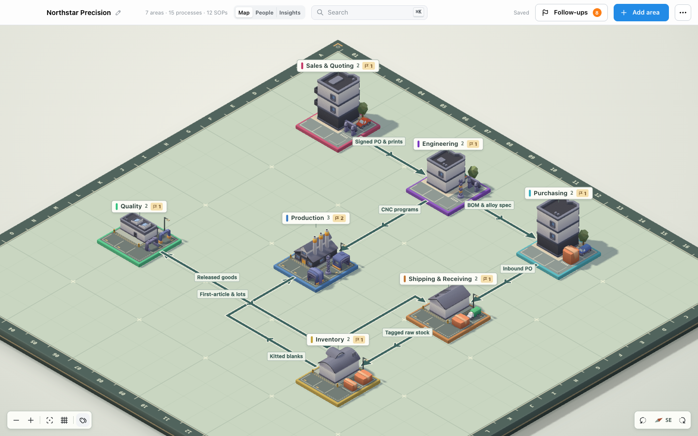
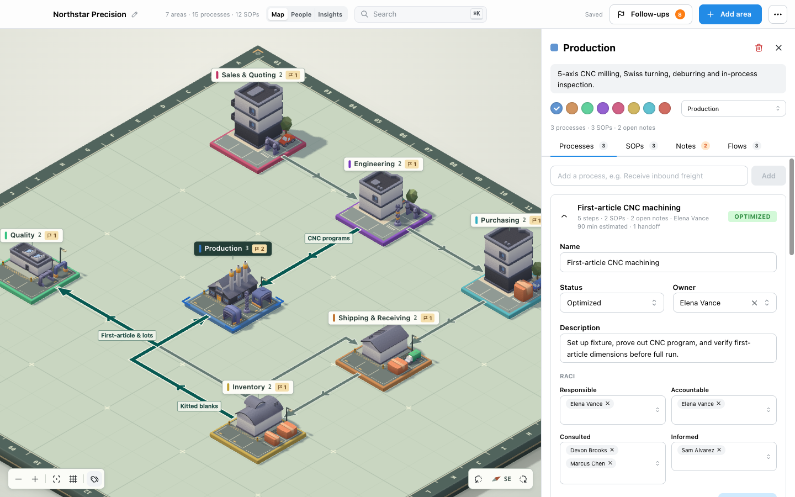
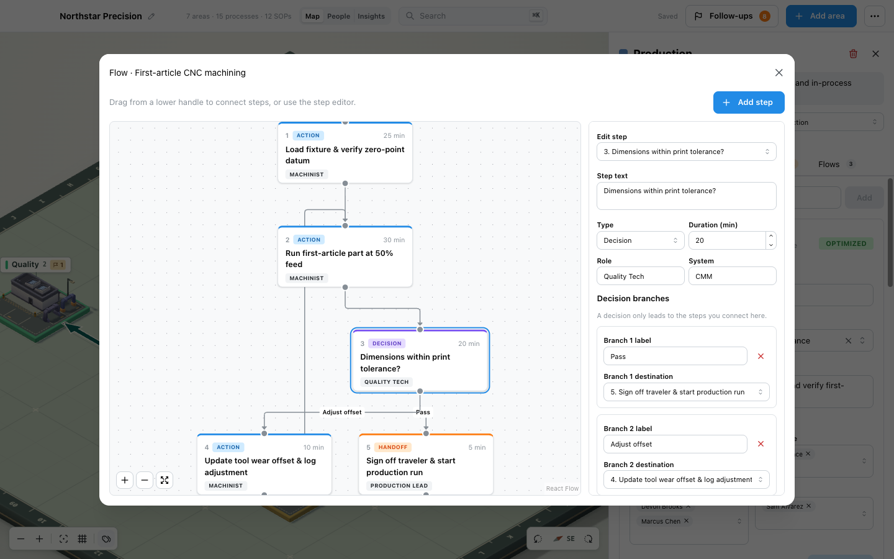
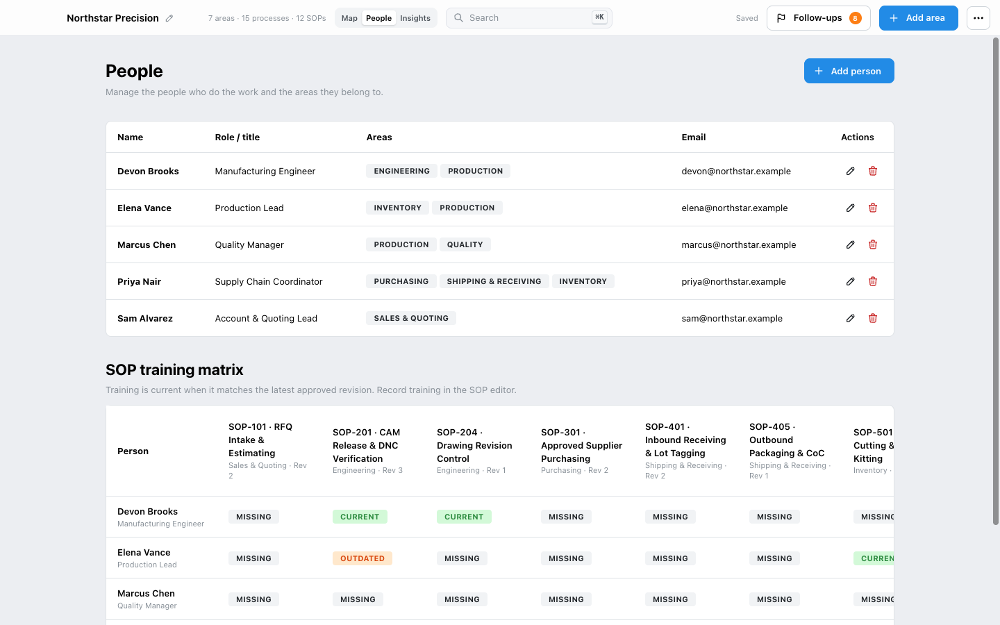
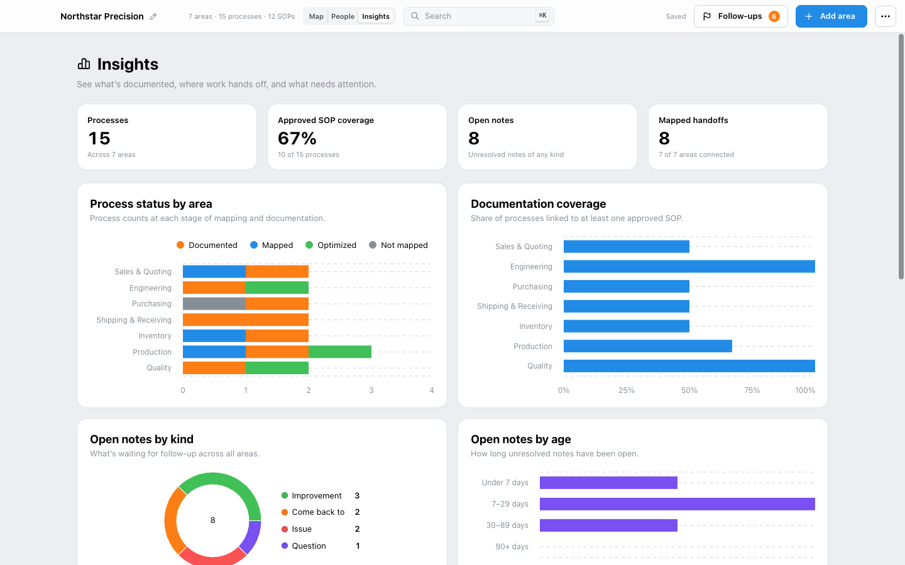

# Cadence

**Map, document, and improve how your business runs on an interactive isometric 3D canvas.**

[](LICENSE)
[](https://github.com/kilwizac/cadence/actions/workflows/ci.yml)

Cadence is a local-first desktop app for turning tribal knowledge into a living operational map. Place each department or business area (Shipping & Receiving, Engineering, Production, Quality, Sales…) on an isometric site model, connect handoffs between them, build out processes and branching workflows, write or attach SOPs, track team training, and surface what needs attention next — all stored privately on your machine.



---

## Features

### Isometric 3D Site Map & Handoffs
- **Build your operational layout:** Choose from 9 area types (Shipping, Inventory, Purchasing, Sales, Engineering, Production, Quality, Maintenance, and Office), place them on an 18×18 site board, and drag lots to reorganize.
- **Equipment grows with your work:** Each process you add populates equipment props on that area's lot, giving you an at-a-glance sense of where work is concentrated.
- **Explore from every angle:** Pan, zoom, frame your areas or the full site grid, rotate the camera across four compass bearings, and toggle map labels on or off.
- **Map handoffs between areas:** Connect areas with labeled directional routes; selecting an area highlights its incoming and outgoing flows.

### Processes, RACI & Editable Flow Diagrams
- **Track maturity:** Move every process from `Not mapped` → `Mapped` → `Documented` → `Optimized`, assign an owner, and define Responsible, Accountable, Consulted, and Informed (RACI) roles.
- **Capture step details:** Record step types (`Action`, `Decision`, `Handoff`, `Wait`), responsible roles, systems/tools, and estimated durations.
- **Visual workflow editor:** Open any process as an interactive flow diagram to connect steps, branch decision outcomes, and spot handoff bottlenecks.





### SOPs, Revisions & Exports
- **Write or attach:** Draft SOPs in a built-in rich-text editor (with a starter template) or drag and drop existing PDFs, Word docs, spreadsheets, and images. Attached files are copied into Cadence's local library so links never break.
- **Governance built in:** Manage `Draft` → `In review` → `Approved` status, automatic revision bumping on approval, and recurring review schedules.
- **Shareable exports:** Export individual SOPs to **PDF** or **Word (`.docx`)**, or generate a complete **Operations Manual PDF** with a cover page, table of contents, processes, SOPs, and an appendix of open improvement notes.

### People Directory & SOP Training Matrix
- Maintain a directory of team members, roles, and area memberships.
- Track who is **Current**, **Outdated**, or **Missing** training against the latest approved revision of every SOP.



### Insights, Notes & Instant Search
- **Insights dashboard:** See process status by area, approved SOP coverage, open notes by kind (`Improvement`, `Come back to`, `Issue`, `Question`) and age, mapped handoffs, and upcoming or overdue SOP reviews.
- **Follow-ups drawer:** Collects every unresolved note across the entire map in one place.
- **Spotlight search (`⌘K`):** Jump straight to any area, process, SOP, or open note.



### Local-First Data & Safe Backups
- Everything autosaves locally — no accounts, subscriptions, or cloud sync required.
- On macOS, data lives in `~/Library/Application Support/Cadence/` (`workspace.json` + `attachments/`).
- Cadence automatically creates daily `.cadence` backup archives (retaining the latest 14 days), lets you save manual backups anytime, and saves a safety copy before restoring.

---

## Getting Started

### Prerequisites
- [Bun](https://bun.sh/)
- [Node.js 24](https://nodejs.org/)
- On macOS, Xcode Command Line Tools (`xcode-select --install`) are required for generating app icons or packaging distributables.

### Run from source

```sh
git clone https://github.com/kilwizac/cadence.git
cd cadence
bun install
bun run dev      # Vite + Electron with hot reload
```

To run a production build locally:

```sh
bun run start
```

---

## Development, Testing & Packaging

| Command | Description |
| --- | --- |
| `bun run dev` | Start Vite and Electron with hot reload |
| `bun run start` | Run a production build and launch the app |
| `bun run typecheck` | Type-check the renderer, main process, and shared code |
| `bun run test` | Run unit tests |
| `bun run smoke` | Build and exercise the app in a hidden offscreen window (uses a temp workspace) |
| `bun run build` | Type-check and bundle the renderer, main process, and preload script |
| `bun run notices` | Regenerate `THIRD_PARTY_NOTICES.txt` after changing runtime dependencies |
| `bun run icon:mac` | Regenerate `build/icon.png` and `build/icon.icns` |
| `bun run package:mac` | Build macOS `arm64` and `x64` DMGs and ZIPs under `release/` |

### Building macOS releases

Pushes to `main` run typecheck, unit tests, and build in GitHub Actions (`.github/workflows/ci.yml`). To build downloadable macOS packages in CI, trigger the **Cadence CI** workflow manually from `main` and download the **Cadence-macOS** artifact.

Code signing and notarization are optional:
- Set `CSC_LINK` and `CSC_KEY_PASSWORD` to sign with a Developer ID Application certificate.
- Set `APPLE_ID`, `APPLE_APP_SPECIFIC_PASSWORD`, and `APPLE_TEAM_ID` to notarize signed builds.
- For an unsigned local build, run `CSC_IDENTITY_AUTO_DISCOVERY=false bun run package:mac`. Note that macOS Gatekeeper may block unsigned or unnotarized downloads distributed to other users.

---

## Architecture & 3D Assets

- `electron/` — Electron main process (local storage, `.cadence` backups, PDF/DOCX export, `app://` protocol handler) and sandboxed preload bridge.
- `src/renderer/` — React 19 + Mantine 9 UI built with Vite; `src/renderer/map/` renders the orthographic isometric 3D scene with React Three Fiber.
- `src/shared/` — Domain types and IPC bridge contracts shared between main and renderer processes.

### 3D models

Bundled 3D models live in `src/renderer/public/models/` and are curated from [Kenney](https://kenney.nl/)'s Factory Kit, City Kit (Industrial), City Kit (Commercial), and Car Kit under Creative Commons CC0. See [`src/renderer/public/models/ASSET_MANIFEST.md`](src/renderer/public/models/ASSET_MANIFEST.md) for source links, license provenance, and SHA-256 checksums, and [`src/renderer/public/models/LICENSE-kenney.txt`](src/renderer/public/models/LICENSE-kenney.txt) for the original Kenney notice.

`src/renderer/map/assets.ts` maps each area type to its main building and process props; swap a model by placing a `.glb` in the matching folder and updating its ID there.

---

## License

Cadence is released under the [MIT License](LICENSE).

Third-party dependency notices are recorded in [`THIRD_PARTY_NOTICES.txt`](THIRD_PARTY_NOTICES.txt), and packaged macOS builds include the project license, generated dependency notices, Electron's license, Chromium's notices, and the bundled 3D asset notices.
